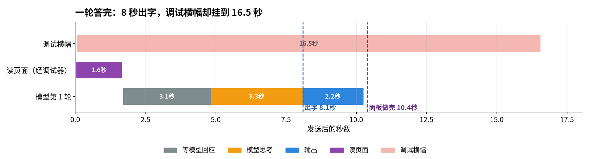
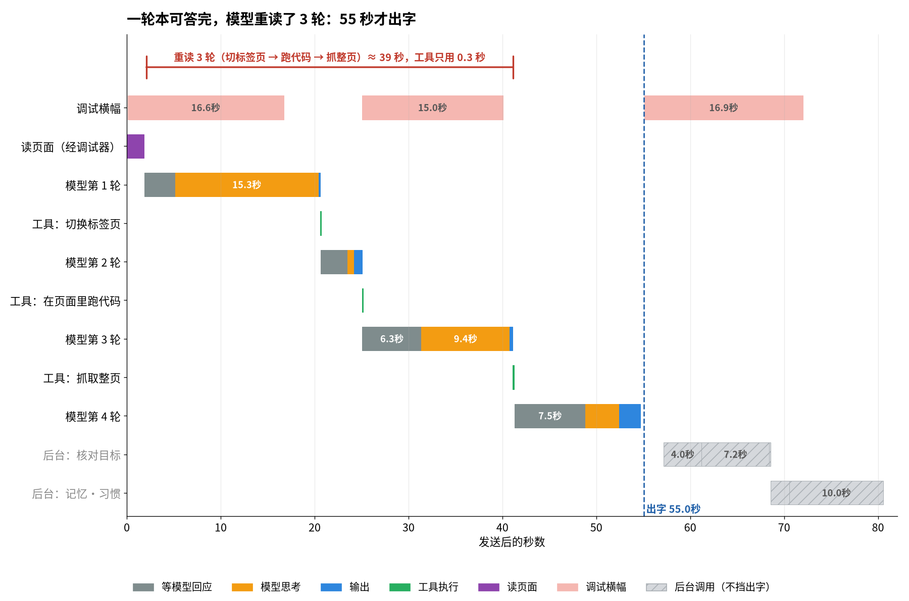
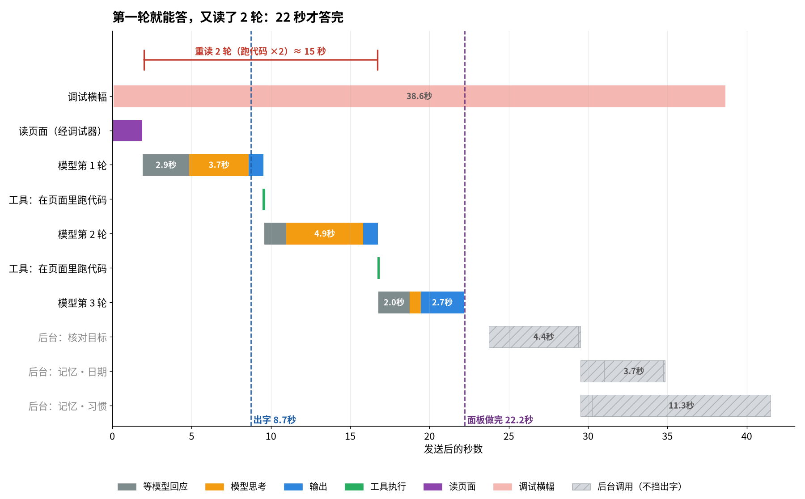
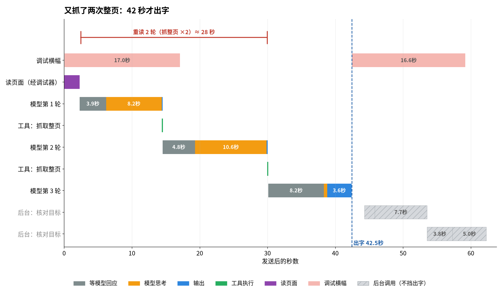
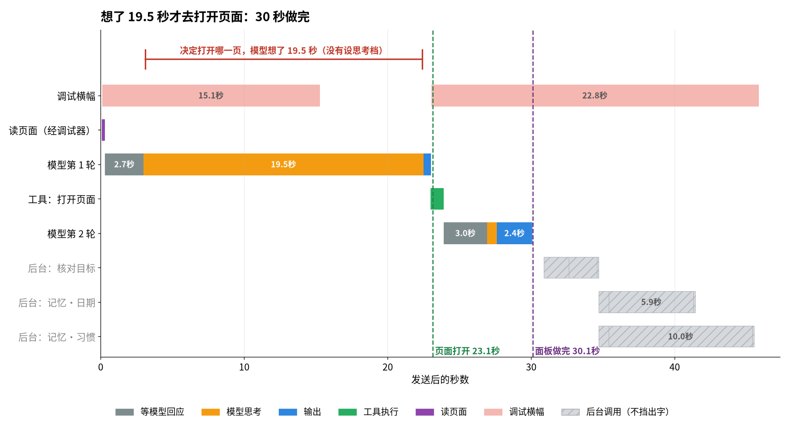
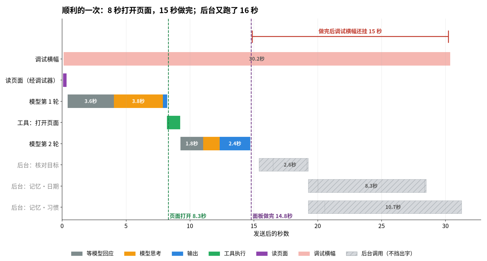
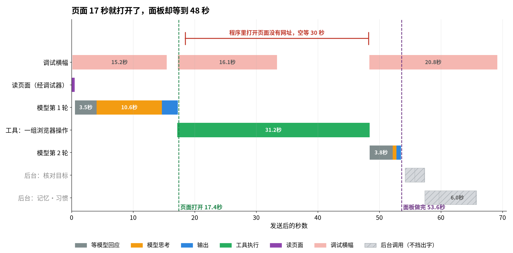
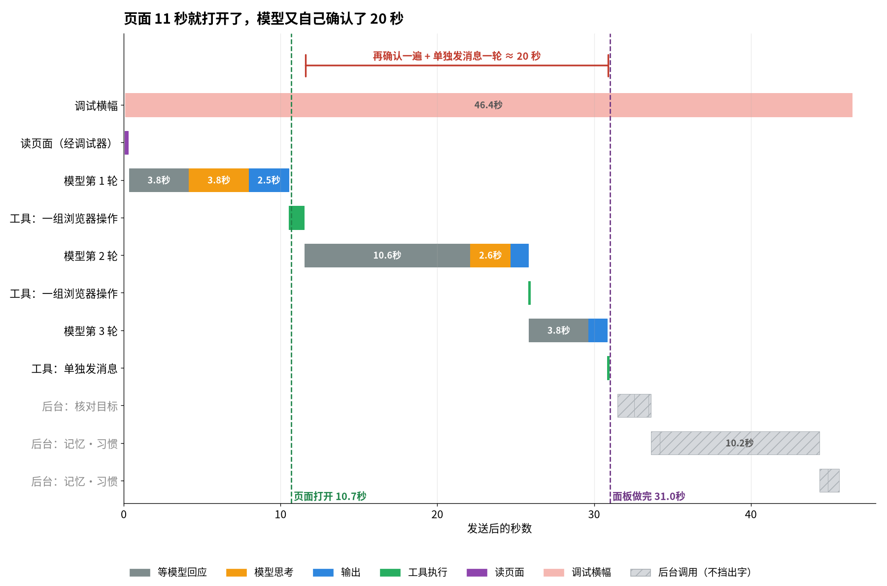
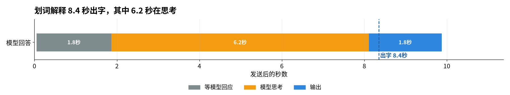
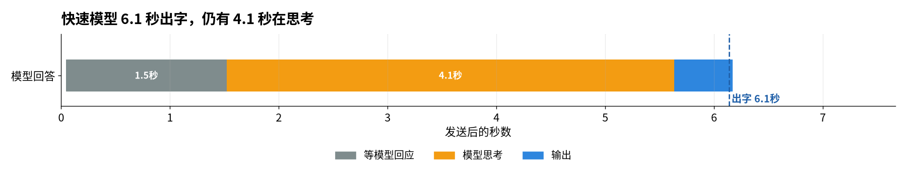

# By Your Side 延迟追踪（latency trace）：时间花在哪

日期：2026-10-11（UTC+8）。代码：`main @ 6a8587b`，`extension/dist` 原样加载。只做分析，没改产品代码，没推送。

## 0. 一句话结论

- 原始模型不慢。step-5-preview 单次请求约 5–10 秒。
- ~70 秒来自管线（pipeline，流水线）：模型不信 12k 字的读页结果，再读 2–3 轮（每轮 5–16 秒）；网页动作里程序写错，空等 30 秒；每轮都背着 ~15k token 固定提示词；思考档（reasoning effort）从不下发，思考时长长尾到 20–34 秒。
- 回答后的后台调用（goal check 目标核对 + memory 记忆判断）不挡首字，但再跑 15–26 秒，调试器横幅（debugger banner）一直挂着。

## 1. 方法（method）

- 驱动：`/workspace/bys-trace/trace-run.mts`。复用 `scripts/acceptance/real-path/harness.mts` 的 `launchRealPath`（隔离无头 Chrome for Testing 145，只装扩展）和 `exportDiagnosticsViaSettings`（设置页「诊断记录 导出」）。
- 模型配置：用 harness 自己的办法（同 `inproc-config.mts` 的 `modelStorageItems`）写扩展存储：`provider=stepfun, modelId=step-5-preview`，key 取自环境变量 `STEPFUN_API_KEY`，没有打印，产物里查过没有 key。
- 通道核对：产品发出的全部 49 次模型请求、重放的 22 次请求都发往 `https://api.stepfun.com/step_plan/v1/chat/completions`（Step Plan），没有按量 `/v1`。没用语音。
- 采集点（全部带毫秒时间戳，同一时钟）：
  - offscreen（任务宿主）网络：请求体（模型、消息、工具、提示词字数）、首字节（first byte）、SSE 流逐块解析（第一个 reasoning 块、第一个正文 content 块、第一个 tool_call 块、结束、usage）。
  - 后台 service worker：运行时包一层 `chrome.debugger.attach/detach/sendCommand`、`chrome.scripting.executeScript`、`chrome.tabs.update`，只记时间，不改行为。
  - 侧栏 UI：每 150 ms 取一次状态行文字、计时读数、步骤卡（chip）耗时、回答字数。
  - 页内划词卡：CDP 穿透 closed shadow root 轮询。
  - 诊断记录（trace jsonl）：`run_start`、`pre_observation`、`model_request`、`first_response`、`tool_execution_*`、`side_call`、`goal_check`。
- 场景：Wikipedia「Summarize this page in 3 sentences」、从 Wikipedia 首页「search Studio Ghibli on Wikipedia and open it」、Miyazaki 页划词「解释」。另加 10-07 基线同题（`page-gist` 练习页 +「这篇文章的核心观点是什么？」），和快速模型 step-3.5-flash 对照。
- 重放（replay）：把产品真实请求体原样重发到 Step Plan，只改 `reasoning_effort`（`replay.py`，结果 `replay.json`）。
- 原始数据：`/workspace/bys-trace/runs/<场景>-r<N>/`（`result.json`、`bodies.json`、`traces.jsonl`、截图）。汇总：`metrics.json`。

## 2. 时间线表（timeline）

时间都从「按下发送 / 点击解释」算起，单位秒。「首字」= 侧栏回答区第一次出现文字。

### 2.1 页面总结（Summarize this page in 3 sentences）

| 运行 | 读页 pre-observation | 主模型轮数 | 首字 | 结束（UI 空闲） | UI 显示 | 后台调用结束 | 调试器 detach |
|---|---:|---:|---:|---:|---|---:|---:|
| r0 | 1.6 | 1 | 8.1 | 10.4 | 10 秒 | 10.2 | 16.5 |
| r1 | 1.9 | 1 | 11.7 | 14.0 | 13 秒 | 13.9 | 16.8 |
| r4 | 1.9 | 1 | 5.7 | 7.6 | 7 秒 | 7.5 | 未 detach（采样已停） |
| fast-r0（快速模型 3.5-flash） | 1.8 | 1 | 11.7 | 13.7 | 13 秒 | 13.6 | 16.7 |
| **r3** | 1.8 | **3**（js×2） | 8.7（开场白） | **22.2** | 22 秒 | 41.5 | 38.6 |
| **fast-r1** | 2.2 | **3**（fetch×2） | **42.5** | 42.5 | 42 秒 | 62.3 | 59.1 |
| **r2** | 1.8 | **4**（tabs、js、fetch） | **55.0** | 55.0 | 55 秒 | 80.5 | 72.0 |

- 7 次里 4 次一轮答完：首字 5.7–11.7 秒。3 次多读 2–3 轮：结束 22–55 秒。这就是用户看到的 ~70 秒那条路。
- r2 拆解（见 `summary-r2.png`）：
  - call0：等首包 3.2 + 思考 15.3 秒，结论是「先切到这个标签页」（tabs）。
  - call1：4.4 秒，写 js 取正文，选择器不对，取回空。
  - call2：16.0 秒（等首包 6.3 + 思考 9.4），改用 fetch 拉整页。
  - call3：13.4 秒（等首包 7.5，提示词 25.3k token），才写回答。
  - 工具执行合计只有 0.26 秒。读页之外，全是等模型。
- 起因（模型自己的思考原文）：「The observation was truncated…」「Let me run a js call to get the lead paragraphs」。读页文字被截到 12,000 字，末尾带 `[same-page observation truncated]`，模型就不信它。

### 2.2 网页动作（search Studio Ghibli on Wikipedia and open it）

| 运行 | 主模型轮数 | 首字 | 页面打开 | 结束（UI 空闲） | 打开后还等 | 后台调用结束 | 调试器 detach |
|---|---:|---:|---:|---:|---:|---:|---:|
| r1 | 2（navigate） | 8.0 | 8.3 | 14.8 | 6.5 | 31.3 | 30.3 |
| r0 | 2（navigate） | 22.5 | 23.1 | 30.1 | 7.0 | 45.5 | 45.8 |
| fast-r0 | 3（browser_run×2 + send_user_message） | 8.1 | 10.7 | 31.0 | 20.3 | 45.6 | 46.4 |
| **r2** | 2（browser_run） | 14.8 | 17.4 | **53.6** | **36.2** | 65.8 | 69.1 |

- r0：第一轮思考 19.5 秒才决定 navigate（`action-r0.png`）。
- r2（`action-r2.png`）：模型写的 `browser_run` 程序是：navigate 到搜索页 → js 找第一条结果 → `if (first) navigate(first.href)`。Wikipedia 搜索直接跳到条目页，js 找不到结果。但 `browser.js` 返回的是 `{value: null}` 包装，`if (first)` 仍为真。于是 `navigate({url: undefined})`：`chrome.tabs.update` 没有发生导航，`waitForInteractive` 等满默认 30 秒。页面 17.4 秒就开了，侧栏却写「正在打开页面」到 48 秒。
- fast-r0：页面 10.7 秒开了，模型又写第二个 `browser_run`「确认 Studio Ghibli 条目内容」（首包 10.6 秒），再用一轮 `send_user_message` 交付。这是「确认」那 20 秒。
- 用户的 1 分 41 秒，形状和 r2 / fast-r0 一致：先一两轮慢思考，页面打开后再被空等或自我确认拖住。

### 2.3 划词解释（selection explain）

| 运行 | 模型 | 等首包 TTFB | 思考 | 首字（卡片） | 完成 |
|---|---|---:|---:|---:|---:|
| r0 | step-5-preview | 1.8 | 6.2 | 8.4 | 10.2 |
| r1 | step-5-preview | 2.8 | 4.3 | 7.5 | 9.4 |
| r2 | step-5-preview | 3.9 | 4.5 | 8.8 | 10.2 |
| fast-r0 | step-3.5-flash（快速模型） | 1.5 | 4.1 | 6.1 | 6.2 |

- 提示词只有 ~566 token，不走 Pi、不读页、不挂调试器。慢全在模型：首包 1.8–3.9 秒 + 思考 4–6 秒。
- 卡片只写「正在回答…」，思考内容不显示。
- 诊断记录导出显示「还没有记录」：划词路径不进诊断记录，只能从网络层量。

### 2.4 每次模型调用（per call，全部运行汇总）

| 用途 purpose | 模型 | n | 等首包 TTFB 中位/最大 | 思考 reasoning 中位/最大 | 输出 中位 | 整次 中位/最大 | 提示词 token |
|---|---|---:|---|---|---:|---|---|
| main 主任务 | step-5-preview | 25 | 3.5 / 10.6 | 3.0 / 19.5 | 1.2 | 8.5 / 22.7 | 15.2k–28.7k |
| goal_check 目标核对 | step-5-preview | 5 | 1.6 / 4.0 | 2.6 / 7.2 | 0.1 | 3.9 / 11.4 | 2.7k–5.6k |
| memory:date 结果日期 | step-5-preview | 3 | 0.8 / 1.5 | 5.9 / 8.3 | 0 | 6.6 / 9.1 | ~350 |
| memory:habit 任务类型 | step-5-preview | 5 | 1.3 / 2.3 | 10.0 / 11.3 | 0 | 12.0 / 12.0 | ~350–500 |
| explain 划词 | step-5-preview | 3 | 2.8 / 3.9 | 4.5 / 6.2 | 1.8 | 9.8 / 9.9 | ~566 |
| goal_check | step-3.5-flash | 3 | 1.5 / 3.8 | 5.0 / 7.7 | 0 | 8.8 / 9.2 | 3k–6k |
| memory:habit | step-3.5-flash | 2 | 0.5 | 5.5 / 10.2 | 0 | 6.0 / 10.8 | ~400 |
| main | step-3.5-flash | 2 | 3.7 | 1.5 | 0.9 | 6.1 | 15–19k |

- 每次请求都流式先吐思考（reasoning_content），再吐正文。StepFun 的 usage 里 `reasoning_tokens` 恒为 0，所以思考量用字符数和时长表示。
- memory:habit 在 step-5-preview 上 5 次有 3 次 12 秒超时（`side_call outcome: failed, reason: timeout`）：一个 350 token 的分类题想了 10 秒以上。
- step-3.5-flash 也会思考：goal_check 和 habit 各有一次写满 1600 token 上限（`finish_reason: length`），没有正文，重试后仍超时。快速模型换成它并不省事。

### 2.5 提示词大小（prompt assembly）

| 部分 | 字符 | 说明 |
|---|---:|---|
| system prompt 系统提示词 | 16,063–16,085 | 每轮都发 |
| tools 工具定义（32 个） | 40,564 | 每轮都发，含 page_translation、guide_step、upload_file 等 |
| pre-observation 读页 | 12,034 | AX tree 文本，截到 12,000 字 |
| 合计首轮请求体 | ~71k 字符 ≈ 19.1k token | usage 实测 |
| 同样外壳 + 3 段小练习页（gist） | ≈ 15.2k token | 说明固定开销约 14.6k token |
| 第 2 轮以后 | 20k–28.7k token | 工具结果（navigate 带回新页快照 24k 字符）累加 |

- 同一任务第二轮起有提示词缓存（cached_tokens 18k+）。第一轮只命中 3.3k。

## 3. 和 10-07 基线（1.8 秒）对比，差距归因

- 10-07 基线（`docs/evals/20261007-time-breakdown.md`）：模型 `openai-codex/gpt-6-luna`，思考档起始 low（`shared/model-capabilities.ts:40` 的 `start: "low"`）。练习页是本机 3 段小页。「首字」取诊断记录 `first_response.elapsedMs`：从 turn_start 到第一个流事件（包括思考事件），不是用户看到的第一个正文字。
- 同定义、同题、同练习页（`gist-r0/r1`）：step-5-preview 首个事件 3.6 / 2.7 秒，侧栏首字 4.6 / 4.1 秒，整轮 5.5–5.7 秒。step-3.5-flash 3.8 秒 / 5.3 秒。
- 父代理的裸 curl（无页面、短提示词）：default 首个正文 4.9 秒 / 共 6.5 秒；low 2.7 / 3.9；medium 6.0 / 6.8；high 5.0 / 5.7。
- 本次真实请求体重放（19k token，各 2 次）：

| 请求体 | effort | 首包 | 首个正文/工具 | 共计 | 思考字符 |
|---|---|---|---|---|---|
| 总结主调用 | 不发（产品现状） | 2.9 / 4.2 | 7.4 / 9.6 | 8.4 / 11.2 | 1285 / 1522 |
| 总结主调用 | low | 3.2 / 2.8 | 3.5 / 7.1 | 5.5 / 7.9 | 90 / 1141 |
| 动作主调用 | 不发 | 3.2 / 2.0 | 4.4 / **34.0** | 4.9 / **34.5** | 415 / **10576** |
| 动作主调用 | low | 3.2 / 2.5 | 5.4 / 5.9 | 5.9 / 6.4 | 829 / 945 |
| 动作主调用 | high | 3.8 / 3.4 | **30.5** / 6.9 | 34.2 / 7.5 | 9047 / 1341 |
| goal_check | 不发 / low | 2.4 / 2.3 | 5.8 / 2.8 | 6.0 / 2.9 | 1241 / 163 |
| memory:date | 不发 / low | 1.6 / 1.7 | 11.9 / 13.4 | 11.9 / 13.4 | 3389 / 4006 |

- 结论：low 不明显降中位数，但砍掉了 30 秒级的长尾。小分类题（memory:date）low 也没用：这类题不该交给思考模型。

### 3.1 从 1.8 秒到 ~70 秒，逐项归因（以 summary-r2 的 55 秒为例，加上实测范围）

| 项 | 秒 | 依据 |
|---|---:|---|
| 指标定义不同：基线是「首个流事件」，用户说的是「首个正文字」 | 同一次调用里差 = 思考时长，中位 3.0，最大 19.5 | §2.4 |
| 模型/服务商首包：gpt-6-luna 1.8 → step-5-preview 2.7–3.6（同题同页） | +1–2 | gist-r0/r1 |
| 提示词大小：15k → 19k token 首包中位 3.5、最大 10.6；第 4 轮 25k token 首包 7.5 | +1–6 每轮 | §2.4、§2.5 |
| 思考档不下发：默认思考，单轮 3–19.5 秒（重放可到 34 秒） | +2–15 每轮 | §3 重放 |
| 额外轮次：模型不信截断读页，再读 2–3 轮 | **+14 ~ +45** | summary r2/r3/fast-r1 |
| 多轮后回答不流式：正文在执行过程里写完，等 agent_end 一次性交付 | +2.6 / +3.7 | r2：网络首个正文 52.4，侧栏 55.0 |
| 读页 pre-observation（AX tree，经 chrome.debugger） | +1.6–2.2（大页） | §2.1 |
| 工具执行、UI 渲染 | <0.3；正文到侧栏 17–125 ms | §2.1、§5 |
| 后台调用（goal check、memory） | 0（不挡首字），但回答后再跑 15–26 秒 | §2.2 |

- 用户 70 秒 > 本次最慢 55 秒。剩下的差最可能是当时 StepFun 首包更慢（本次单轮首包最大 10.6 秒）。首个事件超时是 15 秒（`agent/src/pi-agent-loop.ts:73`）；没设快速模型时会在原模型上重试，一次就多 15 秒以上。这条本次没有遇到，只是推断。用户导出的诊断记录里查 `auto_retry_start`、`retry_after_error`、`model_fallback` 就能确认。

## 4. 四个问题的回答

### 4.1 为什么首字要 ~70 秒

- 一轮能答时只要 6–12 秒：读页 1.8 + 首包 3–7 + 思考 3 + 出字。
- 慢的是多轮：模型拿到 12k 字截断的读页，不相信，先切标签页、再 js、再 fetch，每轮 19–25k token、思考 1–15 秒。3/7 次总结走了这条路。
- 推手：
  - `agent/src/session.ts:113` `PRE_OBSERVATION_TEXT_MAX = 12_000`，`session.ts:1069` 加 `[same-page observation truncated]`。
  - `agent/src/prompt.ts:42`「switch to it if it isn't your working tab」：r2 第一轮想了 15 秒，结论是先 `tabs` 切过去，可读页已经是这个标签页。
  - `shared/model-capabilities.ts:54` 把 step-5-preview 登记成 `reasoning: false`，所以 `agent/src/pi-agent-loop.ts:502` 不发 `reasoning`，诊断记录 `effort: "off"`；服务端按默认档思考，长尾很长。
- 多轮时回答不逐字出现：`extension/src/sidepanel/main.ts:4181`（`leadToolUsed` 后正文进执行过程，等宿主交付），又多 2.6–3.7 秒。

### 4.2 为什么页面打开后还要等 ~40 秒（「确认」）

- 情况 A（r2）：程序空等 30 秒。`browser.js` 返回 `{value: null}`，模型按 `null` 判断写错，`navigate({url: undefined})` 没有导航，`extension/src/background/exec/navigate.ts:19` 默认 30 秒，`:29` `waitForInteractive` 等新文档等到超时。navigate 不校验 url。
- 情况 B（fast-r0）：模型自己再跑一个「确认条目内容」的 browser_run，再加一轮 send_user_message，多 2 轮 ≈ 20 秒。navigate 已经带回新页快照（`agent/src/browser-program.ts:705`），这次确认是多余的。
- 回答显示后，还有 goal check（`agent/src/session.ts:2139` → `:2257` 先再读一次页 → `checkGoal`）和 memory date + habit（`agent/src/memory-runtime.ts:954`、`:1000`）。它们在 UI 上不显示，但再跑 15–26 秒；habit 常 12 秒超时（`memory-runtime.ts:266`）。

### 4.3 为什么步骤显示「执行脚本 0.0s」、思考计时对不上

- 步骤卡（chip）耗时 = 侧栏收到 `tool_start` 到 `tool_end` 的差（`extension/src/sidepanel/main.ts:4003` 记 `start: eventTime()`，`:4055` `recordedDuration`）。js 真实执行 2–25 ms，所以 0.0s 是对的。
- 但两步之间模型思考的 3–19 秒没有步骤卡。只在展开后的「思考过程 Xs」里出现，而且它从第一个思考字算起（`main.ts:3768`），不含等首包（1.4–10.6 秒）。
- 反过来，r2 的「打开了 Studio Ghibli - Wikipedia 30s」是空等，页面早就开了。
- 状态行计时（「N 秒」）：起点是发送时刻 `runStartAt`（`main.ts:5383`），每秒刷新（`main.ts:3179`），终点是 `agent_end`。本次 15 次侧栏运行里，它和真实时间最多差 1.2 秒（取整 + 1 秒刷新）。用户说的「30 秒时显示 6 秒」本次没有复现。代码里能让它从中途重新起算的路径：`finishRun` 把 `runStartAt` 清零（`main.ts:3484`）；发送时只有 `!running && !held` 才重设起点（`main.ts:5383`）；否则 `ensureRun` 用当前事件时刻当起点（`main.ts:3175`）。上一轮的状态还没收尾（例如目标核对判「接着做」、或迟到事件）时，就会从较晚的时刻开始数。这是推断，需用户的侧栏录屏或诊断记录确认。
- 结束时的「做了 N 件事 · N 秒」只算到 `agent_end`，回答后的后台调用（15–26 秒）不算。

### 4.4 为什么只读问题也挂调试器

- 每次发送，宿主先读一次当前页（`agent/src/session.ts:1008` → `:1060` 调 `snapshot`）。`snapshot` 用 `chrome.debugger` 取 `Accessibility.getFullAXTree`（`extension/src/background/exec/snapshot.ts:227`）。
- 实测：发送后 44–158 ms 就 attach；Miyazaki 页取 AX tree 1.5–1.9 秒。
- 空闲 15 秒才 detach（`extension/src/background/debugger.ts:15` `IDLE_MS = 15_000`）。
- 目标核对前又读一次页（`session.ts:2257`），再次 attach。所以横幅在回答后还挂 15–25 秒（例如 action-r0 回答 30.1 秒，detach 45.8 秒）。

## 5. UI 显示时间 vs 真实时间

| 运行 | 真实首字 | 真实结束（UI 空闲） | UI 最终显示 | 运行中计时最大偏差 | 真实最后一次模型调用结束 | 步骤卡显示 | 步骤真实情况 |
|---|---:|---:|---|---:|---:|---|---|
| summary-r0 | 8.1 | 10.4 | 10 秒 | 0.9 | 10.2 | 无 | — |
| summary-r2 | 55.0 | 55.0 | 55 秒 | 0.8 | 80.5 | 切换标签页 0.0s · 执行脚本 0.0s · 发送网络请求 0.2s | 3 步之间模型共想了 38 秒，卡上看不到 |
| summary-r3 | 8.7（开场白） | 22.2 | 22 秒 | 1.0 | 41.5 | 执行脚本 0.0s ×2 | 同上 |
| action-r0 | 22.5 | 30.1 | 30 秒 | 1.2 | 45.5 | 打开页面 0.9s | 打开前想了 19.5 秒 |
| action-r2 | 14.8 | 53.6 | 53 秒 | 0.9 | 65.8 | 31s · 1.1s · 0.0s · 30s · 0.0s | 30s 那步是 navigate(undefined) 空等，页面 17.4 秒已开 |
| action-fast-r0 | 8.1 | 31.0 | 31 秒 | 0.9 | 45.6 | 1.0s · 0.9s · 确认条目内容 0.0s · 执行脚本 0.0s | 「确认」那轮首包 10.6 秒，卡上 0.0s |
| explain-r0 | 8.4 | 10.2 | 不显示计时 | — | 9.9 | 「正在回答…」 | 其中 6.2 秒是思考 |

| 显示 | 实际量的是 | 代码 |
|---|---|---|
| 状态行「N 秒」 | 发送 → 现在（运行中）/ 发送 → agent_end（结束后） | `main.ts:3175`、`:3179`、`:5383`；`steps.ts:321` `spokenDuration` |
| 步骤卡「0.0s」 | 这个工具自己的执行时间 | `main.ts:4003`、`:4055`；`steps.ts:264` `formatDuration` |
| 「思考过程 Xs」 | 这一段思考第一个字 → 这一段结束 | `main.ts:3768`、`:3600` |
| 不显示 | 等首包、多轮之间的间隔、回答后的核对与记忆调用 | — |

- UI 渲染本身不慢：网络上第一个正文块到侧栏出字 17–125 ms；划词卡 240–500 ms（轮询粒度 150 ms）。

## 6. 瓶颈排名与修法（按省下的秒数）

| # | 瓶颈 | 实测代价 | 修法 | 预计收益 | 位置 |
|---|---|---|---|---|---|
| 1 | 页面问答多读 2–3 轮 | 3/7 次，+14 ~ +45 秒 | 读页给正文抽取（main content）而不是 AX tree 前 12k 字；截断提示改成「已含正文前 N 段，够答就直接答」；读页的标签页就当工作标签页，别再 `tabs` 切 | 平均 −12 秒，长尾 −45 秒 | `agent/src/session.ts:113`、`:1069`；`agent/src/prompt.ts:12`、`:42` |
| 2 | 程序里 navigate(undefined) 空等 30 秒 | 1/4 次，+30 秒 | navigate 缺 url 立刻报错；`browser.js` 返回值解包或在工具说明里写清 `{value}` | −30 秒（命中时） | `extension/src/background/exec/navigate.ts:19`、`:29`；`agent/src/browser-program.ts` |
| 3 | 思考档不下发，长尾 20–34 秒 | 单轮思考最大 19.5 秒（重放 34 秒） | 按实测登记 step-5-preview `reasoning: true`，主任务起始 low；同时恢复「快 / 深入」开关 | 中位 −2~4 秒/轮，长尾 −15~25 秒 | `shared/model-capabilities.ts:54`；`agent/src/main-effort.ts:15` |
| 4 | 模型自我「确认」+ 单独交付轮 | +1–2 轮 ≈ 7–20 秒 | 提示词写明 navigate 已带回新页快照，不再验证；交付直接写正文，不另起 send_user_message 轮 | −7~20 秒 | `agent/src/prompt.ts`；`agent/src/browser-program.ts:705` |
| 5 | 固定提示词 ~14.6k token / 32 个工具 | 首包中位 3.5 秒，多轮累加 | 只读问题只带读页类工具；翻译、教学、上传等按需加 | −0.5~1.5 秒/轮 | `agent/src/session.ts`（harness_context 工具列表） |
| 6 | 回答后的后台调用 | 再跑 15–26 秒，habit 3/5 超时 | 后台判断用不思考的模型或 low；date 与 habit 合成一次；只读任务不做 habit；1600 token 上限对思考模型不够 | 后台 −10~20 秒，横幅早关 | `agent/src/side-judgment.ts:208`；`agent/src/memory-runtime.ts:254`、`:266`、`:954`、`:1000`；`agent/src/goal-check.ts:21`、`:162`；`agent/src/session.ts:484` |
| 7 | 只读问题挂调试器 | attach 后至少 15 秒；AX tree 1.5–1.9 秒 | 预读页走 content script 取文字（已有 executeScript）；只有写操作或需要元素编号时才 attach；目标核对读页也一样 | −0.2~1.9 秒/次，横幅消失 | `agent/src/session.ts:1060`、`:2257`；`extension/src/background/exec/snapshot.ts:227`；`extension/src/background/debugger.ts:15` |
| 8 | 多轮后回答一次性出现 | +2.6–3.7 秒 | 最后一轮的正文直接流到回答位置 | −3 秒（多轮时） | `extension/src/sidepanel/main.ts:4181`、`:4195` |
| 9 | 划词解释 7.5–8.8 秒 | 思考 4–6 秒 | 划词用不思考的快速模型；step 模型发 low | −2~4 秒 | `agent/src/reading.ts`；设置页提示已在 `extension/src/settings/main.ts:933` |
| 10 | 看不到在等什么 | 体感 | 分开显示「等模型首包」「思考 Xs」；步骤之间补一行「想了 Xs」；流式显示思考摘要 | 0 秒，体感大 | `extension/src/sidepanel/main.ts:3768`、`:4003` |

- 1+2+3+4 合起来：页面总结回到一轮 6–10 秒；网页动作回到 10–15 秒。

## 7. 每个模型的延迟预算（latency budget，建议）

| 模型 | 实测首包 | 建议：首个可见反馈 | 建议：页面问答首字 p50 / p90 | 建议：单步网页动作完成 p50 / p90 | 后台调用 |
|---|---|---|---|---|---|
| gpt-6-luna（low，10-07 基线） | 1.8（首个事件） | ≤1 秒 | 4 / 8 秒 | 8 / 15 秒 | 快速模型，≤3 秒 |
| step-5-preview（Step Plan，19k token） | 中位 3.5，最大 10.6 | ≤1 秒（状态） | 8 / 15 秒（需 low + 一轮答完） | 15 / 30 秒 | 不用它做后台判断 |
| step-3.5-flash | 中位 3.7（19k）、0.5–1.5（小题） | ≤1 秒 | 7 / 12 秒 | 未测 | 也会思考并撞 1600 上限，不适合作快速模型 |

- 守住预算的做法：主任务超过 2 轮就在侧栏说明原因；单步工具超过 10 秒就显示在等什么；后台判断每次 ≤5 秒，超时不重试。

## 8. 没量到的和原因

- 用户本人那次 70 秒 / 1 分 41 秒的原始记录：没有碰用户的电脑和日常 Chrome，拿不到那次的诊断记录。建议用户在设置页「诊断记录 → 导出」，查 `auto_retry_start`、`retry_after_error`、`first_response`、`pre_observation_failed`。
- 「30 秒时计时显示 6 秒」：15 次侧栏运行没复现，只给出代码里可能的路径（§4.3）。
- 有界面的 Chrome、用户的标签页数和机器负载：本次是隔离无头 Chrome，AX tree 时间可能偏乐观。
- StepFun 不同时段的负载：本次 16:07–16:40 运行，首包最大 10.6 秒；傍晚可能更慢（STATUS 里写过 StepFun 傍晚常挂住）。
- 思考 token 数：StepFun 的 `reasoning_tokens` 恒为 0，只能用字符数和时长。
- `browser_run` 内部每一步的时间：诊断记录里没有 `program_step` 行（导出里查不到），只能用侧栏步骤卡读数和后台 `chrome.tabs.update` 时间对。
- 划词路径不进诊断记录，只能从网络层量。
- 样本少：总结 7 次、动作 4 次、解释 4 次、重放每格 2 次。数字只说明量级。
- gpt-6-luna 同题对照：盒子里的 ChatGPT 登录已过期，没有跑；基线数字取自 10-07 文档。

## 9. 文件

- 报告：`/workspace/bys-trace/REPORT.md`
- 瀑布图（waterfall，v2 中文版）：`*-v2.png`，含 `action-fast-r0-v2.png`；画图脚本 `v2.py`。旧版：`summary-r0.png`、`summary-r2.png`、`summary-r3.png`、`summary-fast-r1.png`、`action-r0.png`、`action-r1.png`、`action-r2.png`、`explain-r0.png`、`explain-fast-r0.png`
- 脚本：`trace-run.mts`（驱动）、`batch.sh`、`batch2.sh`、`analyze.py`（指标与画图）、`replay.py`（effort 重放）、`show.py`
- 数据：`runs/*/result.json`、`runs/*/traces.jsonl`、`runs/*/bodies.json`、`metrics.json`、`replay.json`
