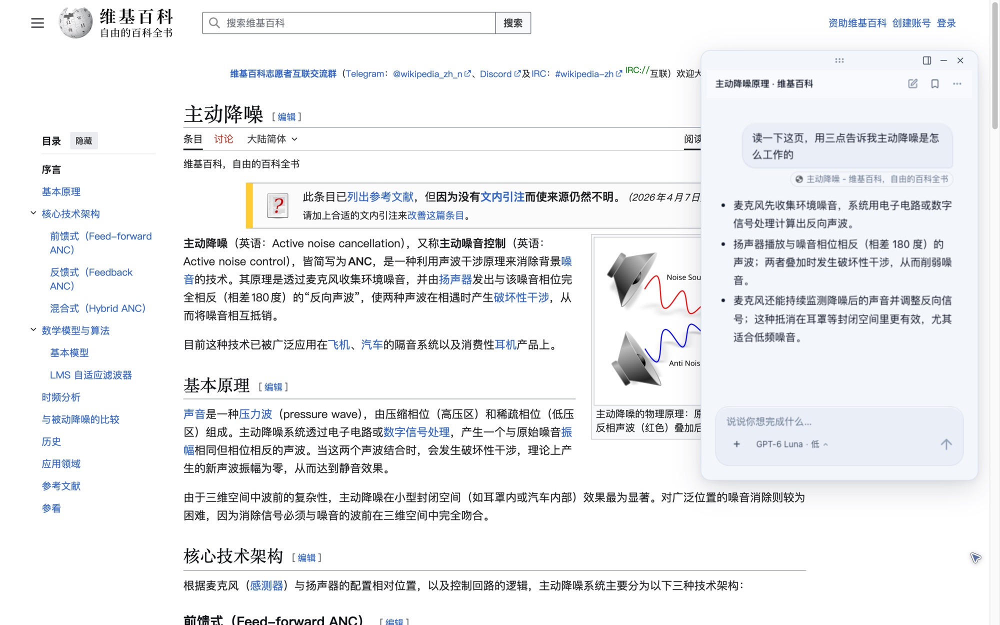

<div align="center">
  
  <h1>By Your Side</h1>
  <p><em>在你的 Chrome 里，陪你读网页，也替你动手。</em></p>
  <p>
    <a href="docs/guides/getting-started.md">安装</a> ·
    <a href="docs/guides/usage.md">使用说明</a> ·
    <a href="docs/STATUS.md">当前状态</a>
  </p>
  
  
  <a href="https://github.com/yishu-ziyu/By-Your-Side/commits"></a>
</div>

<p align="center">
  
</p>

## 为什么做

网页上的事，大多发生在你已经登录的网站里。By Your Side 是一个 Chrome 侧栏扩展：助手就在你正用的浏览器里，用你现有的登录状态读页面、点击、填写、整理结果。你交代一句，它去做；每一步你都看得见，随时可以拿回来。

## 功能

- **读懂页面**：整页和 PDF 都能读，回答给出结论和依据；比价、清单、步骤画成卡片
- **就地追问**：选中文字按 `⌘J`，在页面里解释、翻译、接着问
- **整页翻译**：译文原地替换原文，可切双语、换字体、恢复原文
- **替你动手**：搜索、点击、填写、跨页搬运；任务跑到一半也能改要求
- **开口就行**：按住右 `⌥` 说一句话，不开侧栏也能交代任务
- **浮在页面上**：会话可以从侧栏变成网页上的浮动卡片，全屏时也在
- **你说了算**：每次动手写「做了 N 步 · 耗时」；点「接管」它立刻停手；发送前要你确认，付款按钮永远你自己点
- **数据去向清楚**：页面内容只发给你自己连接的模型服务，密钥只存在这个浏览器里，记下的资料可改可删

> **注意**：普通点击和填写不逐次确认。在不信任的网页上让助手动手前，先看一眼页面，网页里藏的指令可能误导助手。详见[数据和权限](docs/guides/usage.md#数据和权限)。

## 快速开始

目前只支持 macOS + Chrome 源码安装，需要 Node.js 22.19 以上。

```bash
git clone https://github.com/yishu-ziyu/By-Your-Side.git
cd By-Your-Side
npm ci && npm run build
```

1. 打开 `chrome://extensions`，开启「开发者模式」
2. 点「加载已解压的扩展程序」，选 `extension/dist/`
3. 点工具栏的 By Your Side 图标打开侧栏，在「更多 → 模型与语音」填入模型密钥

模型选择和语音设置见[源码安装](docs/guides/getting-started.md)。

## 文档

- [使用说明](docs/guides/usage.md)：全部交互和权限边界
- [当前状态](docs/STATUS.md)：现在做到哪、还差什么
- [架构](docs/architecture.md) · [协议](docs/protocol.md)：代码结构和消息格式
- [AGENTS.md](AGENTS.md) · [开发检查](docs/development/checks.md)：参与开发
- [文档总入口](docs/README.md)：所有文档
