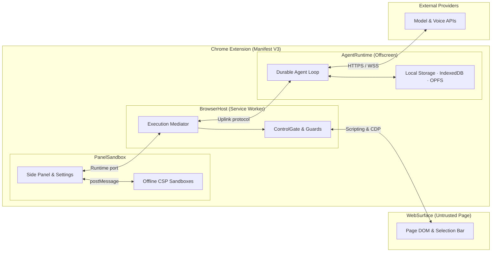
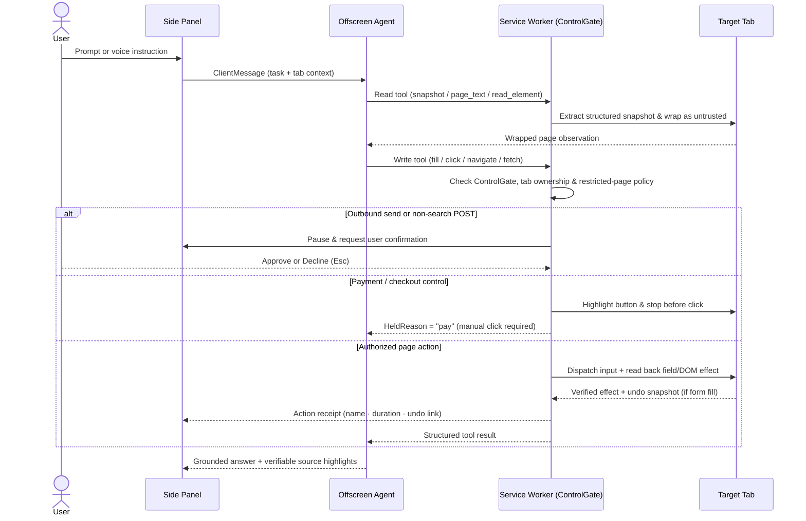

# By Your Side

**An AI agent that works alongside you in Chrome.**

Read pages, navigate websites, and carry out multi-step tasks from a side panel that keeps you in control.

`Chrome Extension (Manifest V3)` · `Local-First Runtime` · `Human-in-the-Loop`

[Chrome Web Store](https://chromewebstore.google.com/detail/by-your-side/emmojfmjolcafmjicpdaeljfgmefacng) · [Quick Start](#quick-start) · [Features](#features) · [See It in Action](#see-it-in-action) · [How It Works](#how-it-works) · [Safety & Control](#safety--control) · [Development](#development) · [简体中文](./README.zh-CN.md)

---

## Why By Your Side?

Most browser work splits across two awkward tools. Standalone chat tabs cannot see what is on your screen, so you spend half your time copying text, describing layouts, and pasting answers back into forms. Headless browser agents go to the other extreme: they spin up an isolated browser without your logins, act out of sight, and stall when a page asks for two-factor authentication or a judgment call.

**By Your Side** lives inside the Chrome you already use. It sits in the native Side Panel next to your open tabs, reads live page structure, and acts inside your active session only when you ask. Every step reports what it did and how long it took. Before sending a message, submitting a non-search request, or touching a checkout button, it stops and leaves the decision to you.

---

## Features

### Grounded reading with verifiable figures
Ask questions across active tabs, background tabs, PDFs, and video captions. First-turn page reads handle modern `display:contents` layouts, surface visible main-text links, and skip unrelated page bodies when a question does not depend on the current page. Numbers drawn from the current page are highlighted in the reply; hovering over a highlighted figure lights up the matching passage on the live webpage without scrolling your viewport away.

### Margin annotations, selection bar, and bilingual translation
Select text on any HTTP(S) page (or press `Cmd+J` / `Ctrl+J`) to open a lightweight text toolbar. Its first button adapts to what you selected: **Generate Chart** for tables, **Add Event** for dates, **Find Route** for addresses, and **Fact-Check** for claims. Replies sit in paper-toned margin cards linked to the source passage. Press `Alt+T` to toggle full-page inline translation, or ask the assistant in the Side Panel to place bilingual translations beside specific paragraphs; page writes are fail-closed unless your turn explicitly authorizes editing the page.

### Multi-step web actions with pre-submit undo
Navigate tabs, click controls, fill forms, select dropdowns, upload or download files, and run multi-step browser programs (`browser_run`). Navigation actions return the arrived page automatically, and clicking or filling a collapsed input surfaces the visible trigger control instead of looping blindly. After writing to form inputs, the extension reads the DOM back to confirm the page kept the expected values, and gives you a one-click **Restore** link on the action receipt before the form is submitted.

### Sandboxed charts, answer UIs, and reusable mini-tools
Generate interactive charts, diagrams, and page-specific mini-tools directly inside an answer. Mini-tools run inside strict offline sandboxes: they read the current page first and trigger page actions only when you click inside the tool. Saved mini-tools and learned site workflows resurface as up to two starter buttons above the input box when you start a new chat on that site.

### Unified voice for conversation and tasks
Talk via push-to-talk dictation or realtime duplex voice without switching between a "chat mode" and a "task mode". Ask a quick question about what you are reading or assign a multi-tab task, listen to the spoken summary, and continue speaking naturally.

### Direct multi-provider connections, no middleman server
Connect straight from the extension's offscreen runtime to your own accounts and keys:
- **Browser OAuth sign-in**: OpenAI Codex (ChatGPT account), GitHub Copilot, Kimi For Coding, and xAI.
- **API keys**: Anthropic, OpenAI, Google Gemini, DeepSeek, OpenDesign, StepFun, OpenRouter, Moonshot AI, MiniMax, Qwen, Zhipu GLM, Groq, Cerebras, Together, Fireworks, Mistral, Hugging Face, Command Code, OpenCode Go, Inception, or any **custom OpenAI-compatible endpoint**.
- **Role routing**: Assign separate **Main**, **Fast**, and **Backup** models with per-provider concurrency gating.

---

## See It in Action

A typical task: asking the assistant to fill out a store reservation form while holding short of submission.


What happens in this turn ([video clip](./extension/assets/demo/fill-a-form.webm)):
1. **Task bound to page context**: You ask *"Fill out the reservation for 4 people, Wang Xiaoming, 13800000000, hold off on submitting"* while viewing the reservation page.
2. **Verified execution receipt**: The agent fills all three inputs, reads back their values, and collapses the work into a single receipt (`3 fields filled · 3s`) with an expandable step trace.
3. **One-click undo before submit**: Because the form has not been sent to the server, the receipt exposes a live undo action to restore the three inputs to their prior values.
4. **Clean handoff**: The agent stops before the submit button so you can inspect the page and submit yourself.

---

## Quick Start

### Option A: Install from Chrome Web Store (Recommended)

Install **[By Your Side on the Chrome Web Store](https://chromewebstore.google.com/detail/by-your-side/emmojfmjolcafmjicpdaeljfgmefacng)** for desktop Chrome (`120+`), then pin the extension or press `Cmd+Shift+Y` (`Ctrl+Shift+Y` on Windows/Linux) and jump to [Connect a model provider](#connect-a-model-provider-required). Chrome updates the store release automatically after each store review.

### Option B: Build and load from source (Development build)

#### Prerequisites

- **Node.js** `>= 22.0.0` (`.node-version` pins Node `22`)
- **npm** (included with Node.js)
- **Google Chrome** `120+` on desktop (macOS, Linux, or Windows)

#### 1. Clone and install dependencies

```bash
git clone https://github.com/yishu-ziyu/By-Your-Side.git
cd By-Your-Side
npm install
```

#### 2. Build the extension

```bash
npm run build
```

This bundles the Service Worker, Side Panel, Offscreen Agent Runtime, Content Scripts, PDF/ONNX/QuickJS WebAssembly assets, and `manifest.json` into **`extension/dist/`**.

#### 3. Load unpacked in Chrome

1. Open `chrome://extensions` in Chrome.
2. Turn on **Developer mode** in the top-right corner.
3. Click **Load unpacked** and select the **`extension/dist`** directory (do not select `extension/` itself; the compiled entrypoints live in `extension/dist`).
4. Pin **By Your Side** to your Chrome toolbar, or press `Cmd+Shift+Y` (`Ctrl+Shift+Y` on Windows/Linux) to open the Side Panel.

### Connect a model provider (Required)

> **Interface language note**: Built-in UI chrome in `v0.2.1` uses Simplified Chinese labels, while prompts, page reading, translations, and answers work in English, Chinese, and other languages supported by your model.

1. In the Side Panel header, open the menu (`...`) and select **Models & Voice (`模型与语音`)** (or right-click the extension icon and open **Options**).
2. Pick a provider and either sign in via OAuth (for example, OpenAI Codex / ChatGPT, GitHub Copilot, Kimi, or xAI) or paste an API key / custom OpenAI-compatible base URL.
3. Wait for the built-in connection probe (`OK` handshake) to pass. Optional: configure separate **Fast** and **Backup** models or voice credentials on the same page.

### Verify on a live page

- Open any article or documentation tab, open the Side Panel, and ask *"Summarize the key claims and numbers on this page."*
- Highlight a paragraph or table on the page and press `Cmd+J` (`Ctrl+J`) to test the margin annotation card, or press `Alt+T` to toggle inline page translation.

---

## How It Works

By Your Side runs entirely inside Chrome as a Manifest V3 extension without a companion cloud backend. Privileged browser APIs stay inside the background Service Worker, while the stateful agent loop runs inside an extension Offscreen Document.

### System Architecture



### Agent Execution and Control Loop

Every tool call passes through effect classification (`shared/effect-policy.ts`) before touching a tab. Read-only observations run directly; state-changing actions must hold active turn and tab ownership, pass confirmation or payment guards, and report observed DOM effects back to the loop.



---

## Safety & Control

Because By Your Side operates inside your signed-in browser, all visited web content, DOM attributes, screenshots, downloads, and model-generated UI code are treated as **untrusted input**. See [`SECURITY_MODEL.md`](./SECURITY_MODEL.md) for the full threat model and component boundaries.

### Enforced Technical Controls

- **Read vs. write gating (`shared/effect-policy.ts`, `shared/control.ts`)**: Declarative read tools (`snapshot`, `page_text`, `read_element`, `video_captions`, `screenshot`) are separated from write tools (`click`, `fill`, `navigate`, `upload_file`, `cdp`, and authenticated `fetch`). Every write operation checks turn identity and `WorkerTabControl` ownership before dispatch.
- **Send and mutating-request confirmation (`extension/src/background/send-confirm.ts`, `shared/request-confirm.ts`)**: Clicking send/publish buttons or issuing non-search `POST` requests pauses execution, highlights the target on the page, and waits for explicit approval in the Side Panel. Pressing `Escape` or declining blocks alternative retry paths (Enter key, script submission, other buttons) for the remainder of that turn.
- **Hard stop before payment (`extension/src/background/pay-stop.ts`)**: The extension refuses to click payment or checkout buttons. It brings the tab forward, outlines the button on the page, and hands the final click to you.
- **Immediate cancellation and tab takeover**: Pressing Stop or taking over a tab occupied by a paused task immediately invalidates the old turn's dispatch token so late model callbacks cannot fire stale browser actions. Cancellation and takeover invariants are checked with bounded verification and 10,000-trace simulation in Quint (`scripts/formal/`).
- **Offline CSP sandboxes (`extension/manifest.json`, `sandbox-offline.ts`)**: Generated answer UIs, charts, and mini-apps run in MV3 sandbox pages with `connect-src 'none'`, `frame-src 'none'`, `worker-src 'none'`, `form-action 'none'`, and WebRTC disabled. Generated code cannot access Chrome extension APIs or make network calls; in-answer mini-tools only trigger page operations after a user click.
- **Restricted browser surfaces (`shared/restricted-page.ts`)**: The agent cannot read or script `chrome://`, `chrome-extension://`, `devtools://`, `view-source:`, `about:` (other than `about:blank`), or Chrome Web Store pages.

### Reversibility and Undo Scope

- **Supported**: Unsubmitted form fills (`extension/src/sidepanel/fill-undo.ts`) can be reverted in one click as long as you stay on the page and have not submitted the form (excluding password inputs and rich-text editors, which are noted explicitly). Full-page inline translation (`Alt+T`) toggles cleanly back to original text, and memory edits can be restored from the memory drawer.
- **Not reversible by the extension**: Once a form is submitted, a message is sent, or a server-side mutation completes, the extension cannot undo remote state.

### Data Handling and Known Security Limits

See [`PRIVACY.md`](./PRIVACY.md) for the full user data and privacy policy (Chinese).

- **Local storage**: Provider credentials, conversations, learned site operations, attached files, and sanitized traces (`shared/trace-sanitize.ts`) are stored locally inside your Chrome profile (`chrome.storage.local`, IndexedDB, and OPFS). Memory backups exported to disk leave extension storage and should be treated as sensitive files.
- **External model providers**: To answer questions or plan actions, relevant page excerpts, screenshots, prompts, and tool results are transmitted over HTTPS/WSS (`credentials: "omit"`) to whichever model and voice providers you configure.
- **Open risks**:
  - Indirect prompt injection from hostile webpage content remains a live risk class for all browser agents; untrusted-content wrapping (`shared/untrusted.ts`) and system-prompt rules reduce risk as defense in depth, not absolute isolation.
  - Background fetch address-space enforcement under local proxy configurations (where Chrome may classify connections as `unknown` or drop `targetAddressSpace` on `new Request(existingRequest)`) is still under active compatibility engineering (`AGENTS.md`).

---

## Development

### Repository Structure

| Path | Responsibility |
| --- | --- |
| [`agent/src/`](./agent/src) | Session management, durable agent loop, tool definitions, model routing, realtime voice, and local memory |
| [`extension/src/background/`](./extension/src/background) | Privileged MV3 Service Worker, CDP/scripting execution, tab ownership, send confirmation, and payment stop |
| [`extension/src/inproc/`](./extension/src/inproc) | Offscreen Document host bridging `agent/` to browser storage (IndexedDB/OPFS), OAuth/API providers, and push-to-talk audio |
| [`extension/src/sidepanel/`](./extension/src/sidepanel) | Side Panel UI, streaming answer cards, verifiable source highlights, fill-undo controls, and sandbox hosts |
| [`extension/src/content/`](./extension/src/content) | In-page selection bar, margin annotation cards, inline translation, visual cursor/marks, and push-to-talk keys |
| [`extension/src/settings/`](./extension/src/settings) | Provider connections, Main/Fast/Backup model picker, dictation, and reading-voice settings |
| [`shared/`](./shared) | Host-agnostic protocol schemas, `ControlGate`, tool effect policy, request classification, and trace sanitization |
| [`scripts/checks/`](./scripts/checks) | Architecture boundary, complexity, zero-comment, UI style/motion token, copy, and contributor checks |
| [`scripts/formal/`](./scripts/formal) | Quint formal state models (`page-control.qnt`, `send-confirm.qnt`) for cancellation, takeover, and confirmation invariants |
| [`scripts/acceptance/`](./scripts/acceptance) | Real-extension end-to-end acceptance runner in isolated Chrome instances |
| [`eval/`](./eval) & [`scripts/gym/`](./scripts/gym) | Benchmark task suites (`tasks.jsonl`, `duplex.jsonl`, `tasks/browser-perf-replay.json`) and evaluation harnesses |

### Common Commands

```bash
# Build unpacked extension into extension/dist/
npm run build

# Run static typechecking across extension and agent workspaces
npm run typecheck

# Run default code quality gate (contributor allowlist, hardcoded-matching, zero-comment rule, complexity, typecheck, build)
npm run check:code

# Run full static gate (adds copy, UI style/motion token, and architecture boundary checks; matches CI Quality workflow)
npm run check:all

# Run deterministic fake-clock & property simulations (*.sim.ts)
npm run sim

# Run Quint formal verification of cancellation & tab-takeover invariants (verify | simulate | negative | witness)
npm run formal -- verify

# Inspect local test environment, model auth status, test sites, and worktrees
npm run lab -- env

# Run headless real-extension smoke test or a specific acceptance case
npm run smoke
npm run lab -- case security-fetch security-mini-apps security-content

# Reload the extension in a running development browser
npm run reload:ext
```

### Worktrees and Deeper Docs

- Use `npm run task -- <branch-name>` to create an isolated Git worktree with dependencies wired up, and `npm run lines` to inspect active worktrees.
- Read [`AGENTS.md`](./AGENTS.md) for engineering conventions (including the strict no-comment policy allowing only `WHY:` and `SAFETY:` prefixes, UI token rules, and real-path testing standards).
- Read [`SECURITY_MODEL.md`](./SECURITY_MODEL.md) for trust boundaries, sensitive assets, and security review rules.

---

## Limitations & Roadmap

### Current Limitations

- **Desktop Chrome only**: Relies on Chrome Manifest V3 `sidePanel`, `offscreen`, and `debugger` APIs (`Chrome 120+`). Mobile browsers and non-Chromium browsers are not supported.
- **Chinese-first UI labels in `v0.2.1`**: Built-in menus, confirmation prompts, and settings pages are currently written in Simplified Chinese, even though the agent can read and reply in English or other languages.
- **Browser-protected pages**: Chrome blocks extensions from reading or acting on `chrome://` pages, other extensions, DevTools, and the Chrome Web Store; for those screens, you have to paste text or a screenshot manually.
- **Complex canvas and custom editors**: Canvas-only apps (such as spreadsheets or WebGL boards) expose limited DOM semantics and rely on screenshot/coordinate fallbacks; rich-text editors do not support one-click form-fill undo.
- **User-supplied model credentials**: No hosted free tier is bundled; you bring your own OAuth subscription or API key.

### Active Engineering Directions

Based on ongoing work in the codebase and issue tracker (with no fixed release dates):
- **Proxy-compatible network address-space isolation**: Preserving public-network-only constraints for background fetches when local proxies cause Chrome to label destinations as `unknown`.
- **Side Panel accessibility**: Turning the new `axe-core` accessibility report suite into enforced UI regression checks.
- **Replay-driven UX & reliability climbing**: Using real-path trace review (`self-use:review`) and paired evaluation (`npm run climb`) to tighten recovery when dynamic pages redraw mid-action.

---

## Contributing & License

### Contributing

1. **Bug reports**: Open a GitHub Issue describing what happened from a user perspective, the target URL (if public), the model provider used, and how to reproduce it.
2. **Feature proposals**: Align on the user problem and expected behavior in an Issue before opening a large pull request.
3. **Pull requests**:
   - Keep changes modular and run `npm run check:code` (plus `npm run check:ui` / `npm run check:copy` when touching UI or text) before submitting.
   - Code comments are stripped by `npm run check:comments` unless prefixed with `WHY:` (non-obvious browser/protocol/security constraints) or `SAFETY:` (narrow typed DOM/library casts).
   - End-to-end fixes should be verified through real extension paths (`npm run lab`) rather than synthetic mocks; see [`AGENTS.md`](./AGENTS.md) for details.

### License

No root `LICENSE` file is currently published in this repository (`"private": true` in `package.json`). Under standard GitHub terms, source code without an explicit license grants no permission for redistribution or commercial reuse beyond viewing and forking on GitHub until the maintainer publishes a license.

License notices for third-party open-source assets bundled into the extension build (such as OpenUI, Lobe Icons, Caveat font, and Voice Orbs) are located in [`extension/licenses/`](./extension/licenses/) and `extension/src/vendor/openui/LICENSE`.
