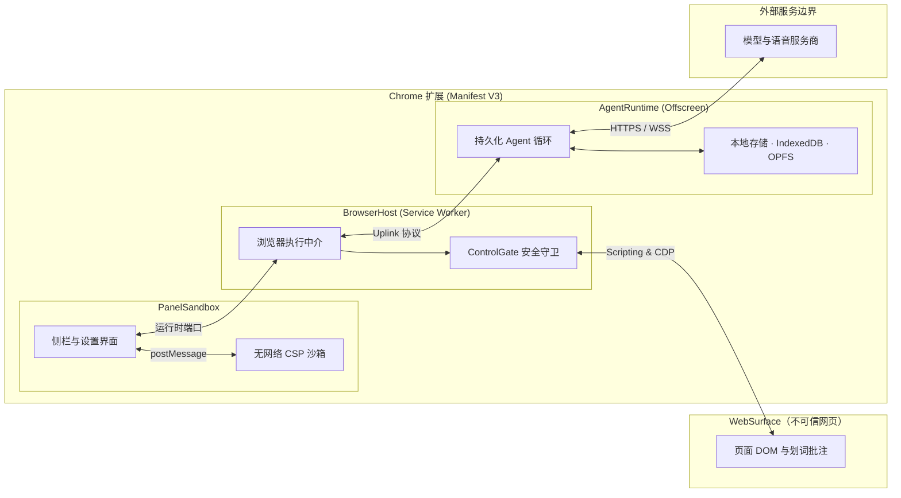
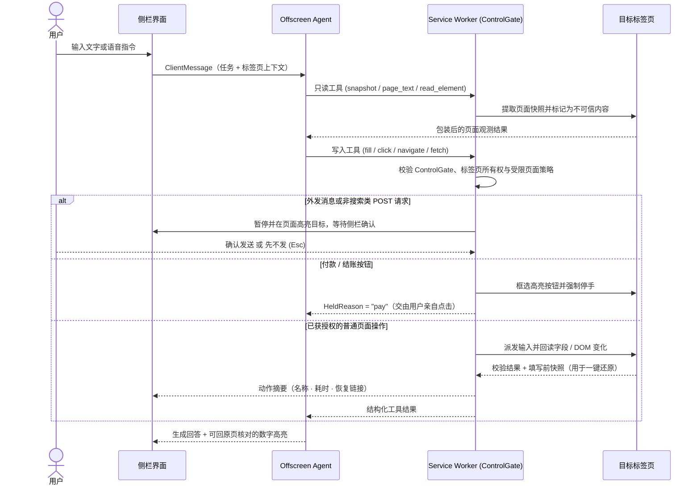

# By Your Side

**在你的 Chrome 里，陪你读网页、也替你动手的 AI 助手。**

在浏览器侧栏里读懂当前页面、跨标签页查资料、填写表单并完成多步操作，关键步骤始终把控制权留给你。

`Chrome 扩展 (Manifest V3)` · `本地运行时` · `人机协同控制`

[Chrome 应用商店](https://chromewebstore.google.com/detail/by-your-side/emmojfmjolcafmjicpdaeljfgmefacng) · [快速开始](#快速开始) · [核心能力](#核心能力) · [实际演示](#实际演示) · [技术架构](#技术架构) · [安全与控制](#安全与控制) · [开发指南](#开发指南) · [English](./README.md)

---

## 为什么做 By Your Side？

日常在浏览器里用 AI 处理事情，往往卡在两头：单独开一个聊天网页，它看不见你眼前的屏幕，你得来回复制正文、描述页面结构、再把结果贴回表单；换成无头浏览器自动化工具，它又跑在隔离的新环境里，没有你的登录态，动作看不见，一遇到验证码、二次确认或需要拿主意的地方就卡住。

**By Your Side** 直接运行在你日常使用的 Chrome 侧栏里。它挨着你正在看的标签页，按需读取真实页面结构、在你已登录的会话里执行操作；每一步都会交代做了什么、耗时多久，遇到发送消息、非搜索类提交或付款按钮时主动停下，由你拍板。

---

## 核心能力

### 带出处核对的伴读体验
支持结合当前页、后台标签页、PDF 文档和视频字幕回答问题。首轮读页兼容 `display:contents` 等现代布局，提取正文中的可见链接，并在问题与当前页无关时自动跳过正文以减少干扰。回答中引用自原网页的数字会以浅底标出，鼠标移上去时，原网页对应位置会直接高亮，不会强行滚走你的阅读位置。

### 页边批注、划词工具条与双语翻译
在任意 HTTP(S) 网页选中文字（或按 `Cmd+J` / `Ctrl+J`）即可呼出纯文字工具条。第一个按钮会随选中内容自动切换：选中表格显示「生成图表」，选中日期显示「加日程」，选中地址显示「查路线」，选中论断显示「查证」。回答以暖纸色批注卡停在页边并连回原文。按 `Alt+T` 可在原文下方逐段展开或还原整页译文，也可以在侧栏要求把指定段落的双语译文放回原页；未获本轮明确授权时，扩展不会改动网页正文。

### 可回读校验、提交前可一键还原的网页操作
支持打开与切换标签页、点击控件、填写表单、选择下拉项、上传下载文件，以及执行多步浏览器程序（`browser_run`）。触发页面跳转的动作会自动带回新页面内容，点到或填到折叠隐藏的输入框时会给出可见展开按钮线索，减少无效试错。写入输入框后会回读 DOM 核对网页是否真正保留了目标值；在表单提交之前，执行摘要上提供「恢复这 N 处填写」入口，一键回到动手前的状态。

### 嵌在回答里的沙箱小工具与图表
可在回答流内直接生成交互式图表、示意图和针对当前网页的现场小工具。小工具运行在无网络的严格 CSP 沙箱中：默认只读当前页，只有你在工具里点击时才触发网页操作。好用的小工具和学会的站点操作可以按域名存下，下次在该网站开启新会话时，输入框上方会自动摆出最多 2 个快捷起手按钮。

### 不分模式的自然语音交互
支持按键说话（Push-to-Talk）听写与实时全双工语音，不区分聊天模式和任务模式。你可以直接开口聊当前网页，也可以口头布置跨页任务，助手朗读完结果后接着往下说。

### 直连多模型服务商，无中间业务后端
模型请求由扩展 Offscreen 运行时直接发往你配置的服务商：
- **浏览器账号登录（OAuth）**：OpenAI Codex（ChatGPT 账号）、GitHub Copilot、Kimi For Coding、xAI。
- **API Key 接入**：OpenDesign、阶跃星辰（Step Plan）、智谱 GLM、DeepSeek、Kimi / Moonshot、MiniMax、通义千问 Qwen、Anthropic、OpenAI、Google Gemini、OpenRouter、Groq、Cerebras、Together、Fireworks、Mistral、Hugging Face、Command Code、OpenCode Go、Inception，以及任意**自定义 OpenAI 兼容接口**。
- **分角色路由**：支持分别指定主模型、快速模型与备用模型，并按服务商自动控制并发队列。

---

## 实际演示

一个典型场景：请助手填写到店预约表单，但在提交前停手交给你核对。


这一轮交互包含四个关键细节（[查看同场景录屏片段](./extension/assets/demo/fill-a-form.webm)）：
1. **绑定当前页面上下文**：你在「预约到店」页面发出指令：「帮我把预约填好：4 个人，王小明，13800000000，先别提交。」
2. **克制的执行摘要**：助手完成填写并回读校验后，默认只折叠展示摘要（`已填 3 项 · 用时 3 秒`），需要时可展开查看明细。
3. **提交前一键还原**：因为表单尚未发给网站，摘要栏直接给出「恢复这 3 处填写」链接，点一下即可撤回。
4. **守住操作边界**：停在提交之前，等你亲自核对确认。

---

## 快速开始

### 方式一：从 Chrome 应用商店安装（推荐）

前往 **[Chrome 网上应用店安装 By Your Side](https://chromewebstore.google.com/detail/by-your-side/emmojfmjolcafmjicpdaeljfgmefacng)**（需桌面版 Chrome `120+`），固定到工具栏或按 `Cmd+Shift+Y`（Windows/Linux 为 `Ctrl+Shift+Y`）打开侧栏，随后跳至[连接模型服务商](#连接模型服务商必选)。商店版会在每次审核通过后由 Chrome 自动更新。

### 方式二：从源码构建安装（开发版）

#### 环境要求

- **Node.js** `>= 22.0.0`（仓库 `.node-version` 锁定为 `22`）
- **npm**（随 Node.js 自带）
- **Google Chrome** 桌面版 `120+`（macOS、Linux 或 Windows）

#### 1. 克隆仓库并安装依赖

```bash
git clone https://github.com/yishu-ziyu/By-Your-Side.git
cd By-Your-Side
npm install
```

#### 2. 构建 Chrome 扩展

```bash
npm run build
```

构建脚本会将 Service Worker、侧栏界面、Offscreen Agent 运行时、内容脚本、PDF/ONNX/QuickJS WebAssembly 资源及 `manifest.json` 完整打包输出到 **`extension/dist/`** 目录。

#### 3. 在 Chrome 中加载扩展

1. 在 Chrome 地址栏打开 `chrome://extensions`。
2. 打开右上角的**开发者模式（Developer mode）**。
3. 点击**加载已解压的扩展程序（Load unpacked）**，选择仓库下的 **`extension/dist`** 目录（注意不要选外层的 `extension/`，编译产物在 `extension/dist` 内）。
4. 将 **By Your Side** 固定到工具栏，或按快捷键 `Cmd+Shift+Y`（Windows/Linux 为 `Ctrl+Shift+Y`）打开侧栏。

### 连接模型服务商（必选）

1. 点击侧栏右上角菜单（`...`），进入**模型与语音**（或右键扩展图标打开**选项**）。
2. 选择一个服务商，完成浏览器账号登录（如 ChatGPT / OpenAI Codex、GitHub Copilot、Kimi、xAI）或填入 API Key / 自定义兼容地址。
3. 等待连接连通性自检通过。可选：在同一页面配置**快速模型**、**备用模型**及语音朗读/听写凭据。

### 首次体验与验证

- 打开任意文章网页，在侧栏提问：「总结这一页的核心观点和关键数字」，把鼠标移到回答中的浅底数字上核对原页高亮。
- 在网页中选中一段话或一张表格，按 `Cmd+J`（`Ctrl+J`）体验页边批注与生成图表，或按 `Alt+T` 测试整页双语对照翻译与还原。

---

## 技术架构

By Your Side 完全以 Chrome Manifest V3 扩展形态运行在本地浏览器中，不依赖自建云端业务服务器。高权限浏览器操作收拢在后台 Service Worker，有状态的 Agent 循环运行在扩展的 Offscreen Document 中。

### 系统组件边界



### Agent 执行与安全控制回路

每次工具调用在触碰标签页前都先经过副作用分类（`shared/effect-policy.ts`）：声明式只读工具直接观测并将网页内容包装为不可信数据；有状态写入操作必须通过轮次令牌与标签页所有权核验，并经过发送确认与付款拦截守卫。



---

## 安全与控制

由于助手运行在你已登录的真实浏览器中，所有网页正文、DOM 属性、截图、下载文件及模型生成的界面代码一律按**不可信输入**处理。完整威胁模型见 [`SECURITY_MODEL.md`](./SECURITY_MODEL.md)。

### 代码已强制执行的控制机制

- **读写分级与控制闸门（`shared/effect-policy.ts`、`shared/control.ts`）**：只读观测工具与改变页面状态的工具严格分离；所有写工具、`cdp` 调用、文件上传及带登录态的 `fetch` 均须通过 `ControlGate` 轮次校验与 `WorkerTabControl` 标签页所有权检查。
- **外发与写请求确认（`extension/src/background/send-confirm.ts`、`shared/request-confirm.ts`）**：点击发送/发布按钮或发起非搜索类 `POST` 请求时，扩展会框选网页目标并在侧栏弹出确认卡；一旦你选择「先不发」或按 `Escape`，当前轮次后续所有变相重试（按回车、换按钮、跑脚本提交）都会被直接拦截。
- **付款前强制停手（`extension/src/background/pay-stop.ts`）**：扩展拒绝代点付款、购买和结账按钮，遇到时会将目标标签页切到前台、高亮该按钮并交给你本人完成点击。
- **即时停止与页面接管**：点击停止或直接动手接管另一个暂停任务占用的页面时，旧轮次的派发令牌立即作废，防止迟到的模型回调继续操作页面。取消与接管的不变量通过 Quint 形式化模型（`scripts/formal/`）做 10 步有界穷举与 10,000 条随机轨迹模拟检查。
- **无网络 CSP 沙箱（`extension/manifest.json`、`sandbox-offline.ts`）**：回答内生成的图表、卡片与小工具运行在 `connect-src 'none'`、`frame-src 'none'`、`worker-src 'none'`、`form-action 'none'` 且移除 WebRTC 的 MV3 沙箱页中，无法调用扩展特权接口或自行联网；现场小工具只有你点击后才触发页面操作。
- **受限页面隔离（`shared/restricted-page.ts`）**：禁止读取或注入 `chrome://`、`chrome-extension://`、`devtools://`、`view-source:`、`about:`（`about:blank` 除外）以及 Chrome 应用商店页面。

### 操作撤销边界

- **支持一键还原**：尚未提交的普通表单填写支持一键恢复到填写前的值（密码框与富文本编辑器除外，界面会明确提示）；整页翻译可按 `Alt+T` 原地还原；记忆抽屉支持恢复被替换或删除的记忆条目。
- **无法由扩展撤销**：一旦表单已提交给网站、消息已发出或远端服务状态已变更，扩展无法撤回服务端结果，需在目标网站内自行修改或取消。

### 数据流向与已知安全限制

完整用户数据与隐私说明见 [`PRIVACY.md`](./PRIVACY.md)。

- **本地存储**：模型凭据、会话记录、站点操作习惯、附件及脱敏后的运行轨迹（`shared/trace-sanitize.ts`）保存在你本机的 Chrome 配置目录（`chrome.storage.local`、IndexedDB、OPFS）。导出的记忆备份文件离开扩展存储边界后包含个人上下文，请妥善保管。
- **外部模型传输**：为完成问答与规划，必要的网页摘录、截图、提示词和工具返回结果会通过 HTTPS/WSS（`credentials: "omit"`）发送给你所选的模型或语音服务商。
- **当前局限与未闭环风险**：
  - 恶意网页正文的间接提示词注入（Indirect Prompt Injection）仍是浏览器 Agent 领域的共性风险；不可信内容包裹（`shared/untrusted.ts`）与提示词边界属于纵深防御，不等同于硬件级隔离。
  - 在部分本机代理环境下，Chrome 可能将连接地址空间标为 `unknown` 或在克隆 `Request` 时丢失 `targetAddressSpace`，后台请求的网络隔离兼容方案仍在持续推进（见 `AGENTS.md`）。

---

## 开发指南

### 目录职责

| 目录 | 职责 |
| --- | --- |
| [`agent/src/`](./agent/src) | 会话管理、持久化 Agent 循环、工具定义、模型路由、实时语音与本地记忆 |
| [`extension/src/background/`](./extension/src/background) | 高权限 MV3 Service Worker、CDP/脚本执行、标签页所有权、发送确认与付款停手 |
| [`extension/src/inproc/`](./extension/src/inproc) | Offscreen Document 宿主，连接 `agent/` 与本地存储（IndexedDB/OPFS）、模型服务商及按键录音 |
| [`extension/src/sidepanel/`](./extension/src/sidepanel) | 侧栏界面、流式回答卡、可核对数字高亮、填写还原控件与沙箱容器 |
| [`extension/src/content/`](./extension/src/content) | 页内划词工具条、页边批注卡、双语段落翻译、光标高亮与语音快捷键 |
| [`extension/src/settings/`](./extension/src/settings) | 服务商连接、主/快/备模型选择、听写与朗读音色设置 |
| [`shared/`](./shared) | 宿主无关通信协议、`ControlGate`、工具副作用分级、请求确认分类与日志脱敏 |
| [`scripts/checks/`](./scripts/checks) | 架构边界、复杂度、无注释规范、样式/动效 Token、界面用词与贡献者白名单检查 |
| [`scripts/formal/`](./scripts/formal) | 取消、接管与发送确认的 Quint 形式化状态模型（`page-control.qnt`、`send-confirm.qnt`） |
| [`scripts/acceptance/`](./scripts/acceptance) | 隔离 Chrome 实例下的真实扩展端到端验收用例 |
| [`eval/`](./eval) 与 [`scripts/gym/`](./scripts/gym) | 任务评测集（`tasks.jsonl`、`duplex.jsonl`、`tasks/browser-perf-replay.json`）与评测运行器 |

### 常用命令

```bash
# 构建扩展到 extension/dist/
npm run build

# 运行 extension 与 agent 工作区的静态类型检查
npm run typecheck

# 运行默认代码门禁（贡献者白名单、硬编码匹配检查、无注释检查、复杂度、类型检查、构建）
npm run check:code

# 运行全量静态检查（额外包含界面用词、UI 样式/动效 Token 与架构边界检查，与 CI Quality 一致）
npm run check:all

# 运行假时钟与性质模拟测试 (*.sim.ts)
npm run sim

# 运行 Quint 形式化状态模型验证（verify | simulate | negative | witness）
npm run formal -- verify

# 查看本机负载、模型登录状态、测试站点与工作树状态
npm run lab -- env

# 运行无头真实扩展冒烟测试或指定安全验收用例
npm run smoke
npm run lab -- case security-fetch security-mini-apps security-content

# 在开发浏览器中热重载扩展
npm run reload:ext
```

### 工作树与深入文档

- 使用 `npm run task -- <分支名>` 创建自动连好依赖的独立工作树，使用 `npm run lines` 查看当前所有工作线。
- 开发规范、设计准则与真实路径测试要求见 [`AGENTS.md`](./AGENTS.md)。
- 信任边界、敏感资产定义与安全审阅规则见 [`SECURITY_MODEL.md`](./SECURITY_MODEL.md)。

---

## 当前限制与演进方向

### 当前限制

- **仅支持桌面版 Chrome**：依赖 Chrome Manifest V3 的 `sidePanel`、`offscreen` 与 `debugger` 接口（需 `Chrome 120+`），不支持移动端浏览器或非 Chromium 内核浏览器。
- **浏览器受限页面不可读**：受 Chrome 安全策略限制，无法读取或操作 `chrome://`、其他扩展页、DevTools 及 Chrome 应用商店页面；涉及此类页面时需手动截图或粘贴文字。
- **纯画布与富文本编辑器限制**：纯 Canvas 应用（如在线电子表格、白板）缺乏 DOM 语义，需退回截图与坐标交互；富文本编辑器内写入的内容暂不支持一键还原。
- **自带模型凭据**：项目不包含托管免费额度，需使用你自己的模型账号登录或 API Key。

### 近期演进方向

基于当前仓库源码与在研工作线（不设固定发版排期）：
- **代理环境下的后台请求网络隔离兼容**：解决本机代理导致目标地址空间被标为 `unknown` 时的公网限制传递问题。
- **侧栏无障碍检查门禁化**：在已有侧栏 `axe-core` 检查报告用例基础上逐步收敛无障碍问题。
- **基于真实回放的交互与恢复优化**：结合 `self-use:review` 回放复审与 `npm run climb` 对照评测，减少动态网页重绘时的操作失手。

---

## 参与贡献与许可说明

### 参与贡献

1. **反馈问题**：欢迎在 GitHub Issues 提交问题，请尽量附上从用户视角看到的现象、复现网址（若公开）、所用模型服务商及复现步骤。
2. **功能建议**：涉及新交互或产品取舍时，建议先在 Issue 中对齐「现在遇到什么麻烦 → 做完看到什么效果」再动手编码。
3. **提交代码**：
   - 提交前请运行 `npm run check:code`（改动界面或文案时加跑 `npm run check:ui`、`npm run check:copy`）。
   - 仓库默认禁止普通代码注释（`npm run check:comments` 会自动拦截），仅保留说明浏览器/协议/安全硬约束的 `WHY:` 与收拢类型缺口的 `SAFETY:`。
   - 功能与修复优先通过真实扩展路径（`npm run lab`）验证，详见 [`AGENTS.md`](./AGENTS.md)。

### 许可证状态

当前仓库根目录尚未发布开源 `LICENSE` 文件（`package.json` 标记为 `"private": true`）。在维护者正式添加许可证前，除 GitHub 服务条款允许的浏览与 Fork 外，默认保留所有权利，不授予商业分发或再授权许可。

扩展构建中打包的第三方开源组件许可声明（如 OpenUI、Lobe Icons、Caveat 字体、Voice Orbs 等）位于 [`extension/licenses/`](./extension/licenses/) 与 `extension/src/vendor/openui/LICENSE`。
