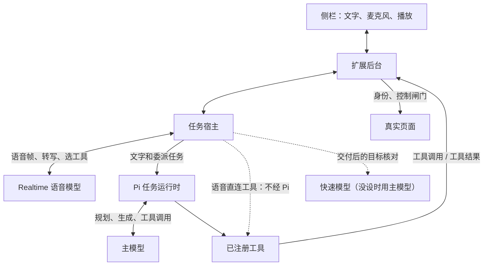

# 架构

[文档导航](README.md) · [协议](protocol.md) · [当前状态](STATUS.md)

本页只写结构为什么这样分、哪些边界是规则。接口、常量与流程以代码为准。

## 扩展宿主边界

- 产品只有扩展形态，见[路线](ROADMAP.md)。会话循环只有扩展内的 Pi 一种。
- 扩展后台负责页面执行、身份检查与控制闸门。任务宿主运行任务核心。
- 当前页面、任务 ID 和执行事实由协议传递，不由模型叙述补造。
- 模型能力只登记在一处，见[模型与思考档](model-effort.md)。

## 主链路图

实线是调用或数据方向，虚线是条件路径。不是每次输入都经过所有节点。

- 语音路径和侧栏文字路径都不设快捷路径或意图预判。
- 语音的明确填写由 Realtime 选工具，任务宿主调用同一个已注册工具，不增加 Pi 推理。所以「不保存/提交」要贯穿要求、工具选择与权限检查，不只靠一句提示词。
- 端到端耗时与各分支使用频率**待验证**，不按模块数估算。

## 职责与事实边界

- Pi 是运行时，不是另一个模型。理解与决策只在 Realtime 与主模型两处。
- Realtime 与 Pi 只提出工具调用。扩展确认任务、页面归属和控制闸门后才执行。
- 请求结果只说明请求去向，不说明网页目标完成，见[语音架构与调度](voice-architecture.md#任务调度多要求与请求结果)。
- 观察凭据只证明一个决定基于一次有效的页面观察，不证明动作已执行。
- 执行事实只由扩展产生。超时或断连时，程序记为结果未知，但这不拦后续操作。单独的成功返回、拒绝或模型叙述都不能当执行事实。
- 动作核验只证明该动作的后置条件，不能代替完整用户目标。
- 中止、插话、改口、接管时，任务原要求、结果未知项和已接受未消费的插话都保留。停声与中止的区别见[语音架构](voice-architecture.md#任务调度多要求与请求结果)。
- 语音回答生成完成不等于播放完成。任务视图、摘要与侧栏缓存都是同一份事实的不同投影，所以不能因为状态同名就把它们合并删掉。
- 工具名、元素编号、原始 JSON、Chrome 错误码等原文只留在记录和模型上下文。用户看到的文字都翻成人话；翻不出时说笼统但真实的话，不回退原文。
- 记忆与 OPFS 会话恢复见[记忆、过往任务与任务跨轮](memory-model.md)。

## 连接、前缀缓存与页面预观察

- 模型请求一律不带用户在网页上的 Cookie（`credentials: "omit"`），避免泄漏网页登录态，并使提前建连接的 `HEAD` 请求与正式模型请求共用同一个连接池。
- 用户聚焦侧栏输入框时，任务宿主并行预取当前页正文与打开标签页清单（5 秒内且标签页 ID 与网址一致时复用），并先完成 `HEAD` 连接预热；仅对按会话号路由前缀缓存的 Codex 服务在 `HEAD` 完成后发一次短请求预热前缀缓存，不在单并发或无会话路由缓存的服务商上多发请求。

## 新任务不让模型手工记账

执行条目由真实的工具结果自动登记。所以新任务不再给模型手工登记的工具，免得模型与自动登记同时维护同一条目。

## 少来回、每次快一点（10-14 定的改法顺序）

用户一周的真实使用里，大部分时间在等模型想下一步，页面操作只占一小部分。所以要快，就要少来回几次、每次来回快一点。改法按这个顺序，前一项量过再做下一项：

1. 点击、填写、按键、选择之后，工具直接带回页面上新出现的东西，只带变化、限长。原因：真实任务里很多次来回只是为了再看一眼页面；10-13 让打开新页直接带回页面后，总来回明显减少。
2. 填写像真人敲键盘，并能“填完直接回车”。先在本机复现“直接改值不生效”，再改。回车即发送的输入框，仍要停在发送确认。
3. 一次回复可以做好几步；跳页或焦点变了，就停下后面的。放在 1 之后，因为停不停要看 1 带回的变化。同类做法：Browser Use 一次最多 5 步，Ego lite 让模型把几步写进一段脚本。
4. 打开、点击、看一眼这类机械步骤改用快模型，要判断的步骤仍用主模型；思考档位“只升不降”的规则一起改。放在 1–3 之后，因为要先知道还剩多少次来回。
5. 加拖动，能在画板上画。

用户一次说了好几件事时，交回答前先对一遍清单，还有没做的就接着做，过程行写做到第几件；只说一件事的照旧先显示回答。原因：真实使用里常常先显示一个像做完的回答，过几十秒再更正。放弃的是“多件事也先出回答”的那几秒。

## 阅读与数据

- GET 取数出错只是取数失败，不记为结果未知。
- 大段数据由程序直接存进会话文件区，不经模型重打。
- 截图默认只进模型上下文。给用户看的规则见[文件、下载与页面阅读](artifacts.md#文本文件与截图)。
