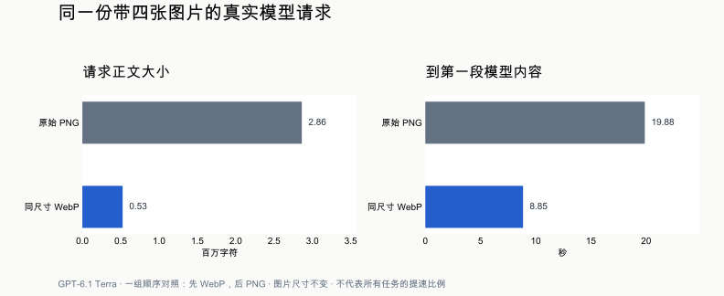

# 读图更快，长任务继续做

这轮来自同一项真实任务：从抖音图集识别专辑，核实 Spotify 链接，再整理到 Excalidraw。

## 从原始运行找到的问题

- 新出现的 ChatGPT 模型只等 15 秒；实际带图请求有 16–30 秒才开始返回的情况。
- 每轮重新发送历史 PNG 截图。一次实际请求带四张图，图片共约 2 MB。
- 固定三分钟后，程序要求助手停工询问；再执行第三个普通工具会被拦下。
- 批量截图只保留最后一张，前面几张虽已执行却没交给模型。
- 下载的图片已在材料里，但读取附件只返回空文字，模型不得不重新开图截图。
- 图片文档没有可读的 body 文字时，整页快照成功也会撤销自动续做。

## 改动与证据

ChatGPT 连接统一采用 30 秒首响应预算。大 PNG 只在传输时转为同尺寸 WebP，保留透明度，会话原图和用户保存的图片不变；相同图片复用编码结果。长任务改为定期提醒进展，实际停滞仍由重复无进展判断。批量读图保留顺序和来源，读取附件能直接返回下载的原图。

这是同一份实际请求的一组顺序对照：先紧凑编码，后原始编码，模型为 GPT-6.1 Terra。两次均返回 HTTP 200；从请求开始到第一段模型内容为 8.85 秒和 19.88 秒。它证明这一样本有效，不是任务成功率，也不能外推为所有请求都提速同样比例。

| 回归场景 | 旧版 | 修复后 |
|---|---|---|
| 图片请求第 18 秒返回 | 两轮均被取消 | 第一轮接住结果 |
| 一个程序读两张不同图片 | 只收到最后一张 | 两张都收到且来源对应 |
| 超过三分钟仍有剩余网页操作 | 第三步被拦下 | 后续页面实际打开 |
| 图片页没有 body 文字，仍须继续 | 停在未完成 | 自动打开后续结果页 |
| 下载图片后读取附件 | 没有图片内容 | 原始字节进入模型输入 |
| 真模型读取重新编码后的画面 | 未作同题对照 | 正确读出画面核对码 |

上述程序回归使用隔离真实扩展、本机页面和脚本模型；最后一项使用真实 Terra。核对码只画在 canvas 里，页面正文不包含答案。原图集到完整画布的最终交付另行验证，不能由这些回归代替。

[图片编码原始读数](evidence/encoding.json) · [实际请求计时原件](evidence/transport.json) · [相关产品理解](../../perspectives/2026-11-01-outcome-first.md) · [产品记录](../../README.md)
